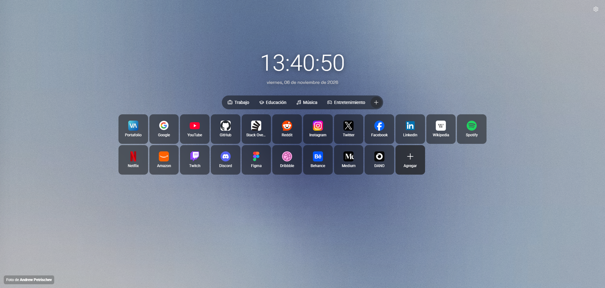

# StartPage

> A minimalist, ad-free, and customizable new tab page for your browser.

## 🚀 Current Status
**Work in Progress (Beta)**. The core UI is built, the real-time clock is active, and the settings modals are functional. We are currently finalizing the core logic. A downloadable ZIP release to easily add this to your browser extensions will be available soon!

## ✨ Features
- **Minimalist Design:** A clean, cover-style dashboard to keep you focused.
- **Quick Access Hub:** Navigate to your favorite sites instantly. No search bar, just pure speed.
- **Organized Profiles:** Group your links (e.g., Work, Education, Entertainment) using beautiful **Lucide Icons**.
- **Real-Time Clock:** A precise 24-hour format clock displaying live seconds.
- **Interactive Modals:** Clean, responsive dialog boxes for configuration and setup.

## 🗺️ Roadmap (Coming Soon)
- Drag and drop functionality to easily reorder your shortcuts.
- 12-hour clock format option.
- Future customization features.

## 🛠️ Tech Stack
- **React**
- **Vite**
- **Tailwind CSS**
- **pnpm**
- **Lucide Icons**

## 📦 Installation
*The packaged extension (ZIP) and installation instructions for Developer Mode will be added in a future release once the core logic is 100% complete.*