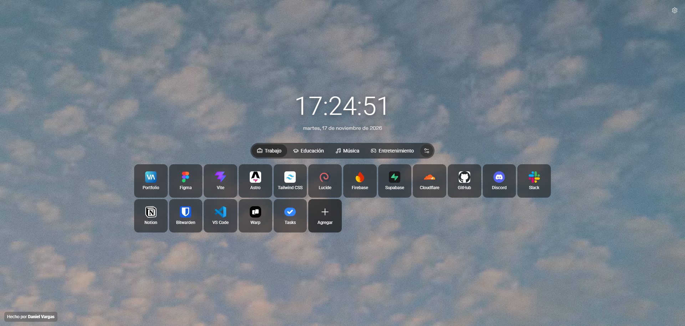

# StartPage

> A minimalist, ad-free, and customizable new tab page for your browser.

## 🚀 Current Status
**v1.1.0 — Stable Release**. StartPage is ready for daily use! Download the latest packaged ZIP from the [Releases](../../releases) page and load it directly into your browser.

## ✨ Features
- **Minimalist Design:** A clean, cover-style dashboard to keep you focused.
- **Multi-Language Support:** Switch seamlessly between **English** and **Spanish** across the entire interface.
- **Backup & Restore:** Export and import your groups, shortcuts, and preferences anytime via JSON files.
- **Custom Backgrounds & Colors:** Set a custom background image with a quick visibility toggle, upload a local image, or choose from a curated palette of solid Tailwind CSS colors (plus a custom color picker).
- **Quick Access Hub:** Navigate to your favorite sites instantly. No search bar, just pure speed.
- **Multiple Favicon Providers:** Choose between Google, DuckDuckGo, Icon Horse, or Yandex to ensure crisp logos for all your shortcuts.
- **Drag & Drop Organization:** Reorder your links and groups effortlessly with intuitive drag and drop.
- **Organized Groups:** Categorize your shortcuts (e.g., Work, Education, Entertainment) using **Lucide Icons**, with quick options to show or hide groups.
- **Flexible Real-Time Clock:** Switch between 12-hour and 24-hour formats with live seconds and size options.
- **Instant Auto-Save & Safe Modals:** Changes save automatically in real time without extra clicks, with explicit close controls to prevent accidental dismissals.
- **Local & Private:** All your settings and links are stored locally in your browser (`localStorage`).

## 🛠️ Tech Stack
- **React**
- **Vite**
- **Tailwind CSS**
- **pnpm**
- **Lucide Icons**

## 📦 Installation
1. Go to the [Releases](../../releases) section on the right side of this repository and download the latest `startpage-v1.1.0.zip` file.
2. Extract (unzip) the downloaded file into a permanent folder on your computer.
3. Open your Chromium-based browser (Brave, Chrome, Edge, Arc) and go to `brave://extensions` or `chrome://extensions`.
4. Enable **Developer mode** in the top right corner.
5. Click **Load unpacked** and select the extracted folder containing the `manifest.json` file.
6. Open a new tab (`Ctrl + T` or `Cmd + T`) and enjoy!